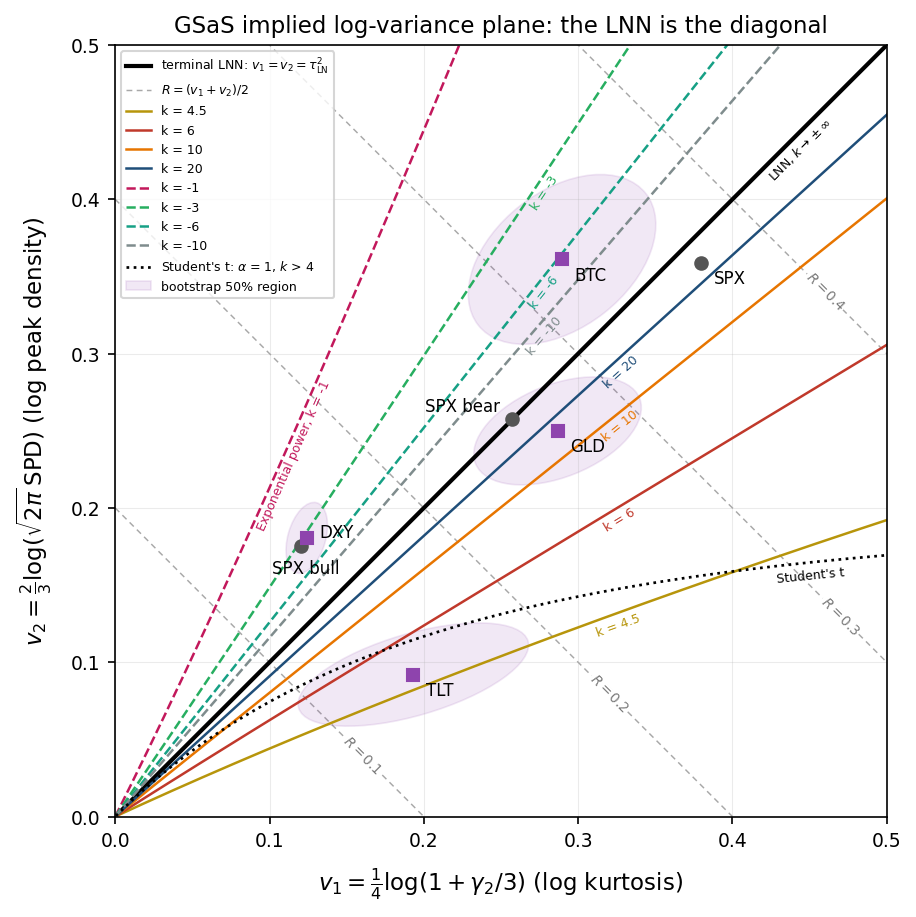
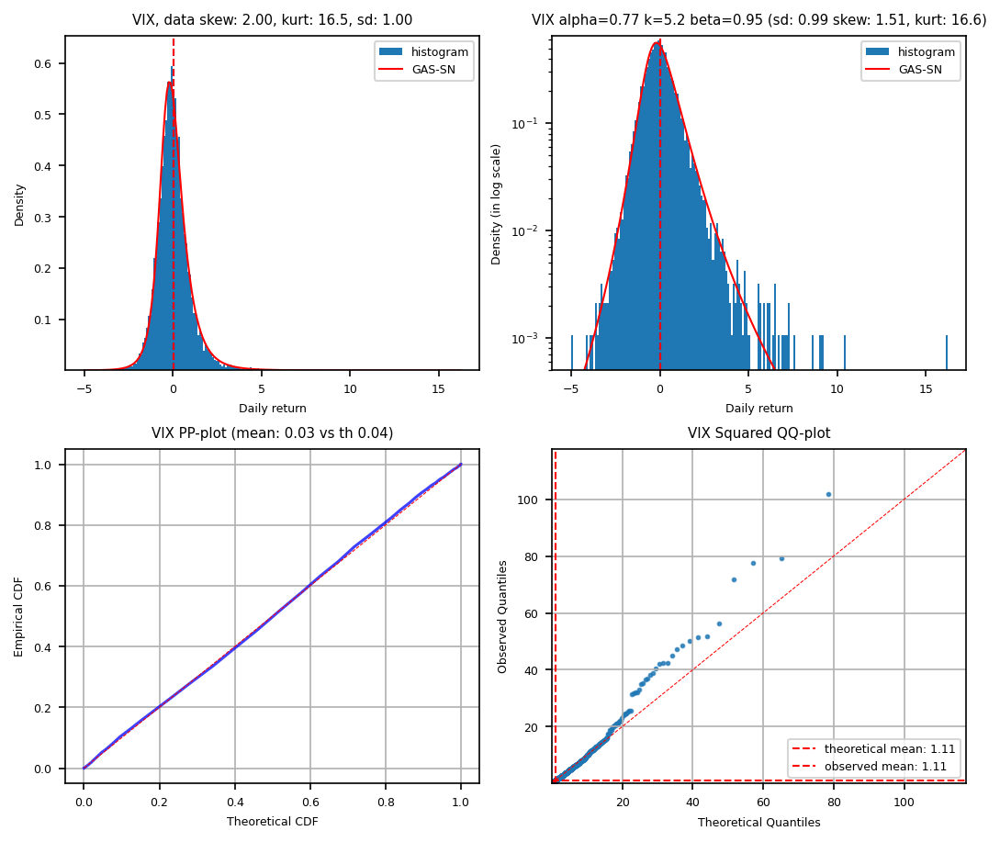
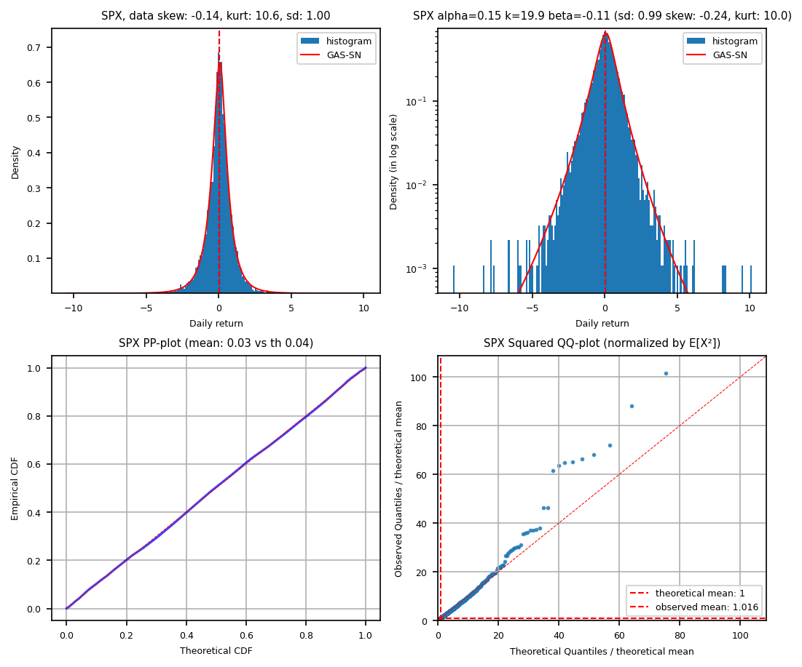
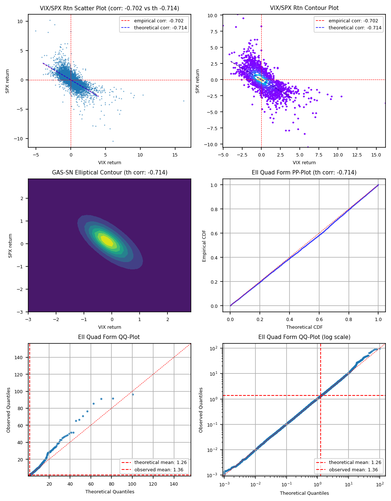

<div align="center">

# gas-impl

### The Fractional Distribution Family

**[📖 The book (fracdist.pdf)](docs/fracdist.pdf)** &nbsp;·&nbsp;
**[🎞️ Oct-27 slides](docs/frac_slides.pdf)** &nbsp;·&nbsp;
**[📄 2024 paper (arXiv)](https://arxiv.org/abs/2405.04693)**



</div>

## Overview

The fractional distribution family extends and combines many classic distributions (see table below) with
* the fractional shape parameter $\alpha$, aka the Lévy stability index;
* the "degree of freedom" parameter: $d$ in fractional gamma or $k$ in fractional chi; and
* the multivariate skew-normal kernel $N(0, \Omega, \beta)$.

This distribution family is the most flexible distribution to date; it can fit data sets with sharper peak, large kurtosis, and high skewness.

Two major univariate distributions are:

* **GSAS**: generalized symmetric alpha-stable distribution
* **GAS-SN**: generalized alpha-stable distribution with skew-normal family (reduced to GSAS when skewness is zero)

It is proved that the return distribution of most financial assets could be fitted successfully with either GSAS or GAS-SN.

The content is written in a book format, available [here (fracdist.pdf)](docs/fracdist.pdf).
The [Oct-27 slides](docs/frac_slides.pdf) summarised the overall structure quite well. Talk was given on Oct 27, 2026 to celebrate Professor Mulvey's 80th birthday.

### The lognormal-normal limit and the tempered stable approximation

In September of 2025, the lognormal-normal (LNN) limit has been found in GSAS (the symmetric case of GAS-SN). 
A canonical coordinate system and the phase diagram were proposed as shown in the chart above.
Any financial asset can be located on the chart from its kurtosis and peak density.

Near such lognormal limit of fractional chi, a connection between its log variable and the tempered stable law has also been found.
I think the discovery of this limit is a big breakthrough for applications to real-world data.

## List of Distributions

In late 2025, I decided to call this group of new distributions **The Fractional Distributions**.
Many classic distributions are generalized into fractional distributions.

In mid-2026, the relation between the three-parameter **tilted stable law** $T_{a,b}^{c}$ (Devroye, 2009) and fractional gamma/chi was established.

The following table lists the mapping from the classic distribution to the fractional distribution and its random variable:

| Classic&nbsp;distribution | Classic Notation | Fractional distribution | Fractional notation | Tilted stable law equiv. |
|---|---|---|---|---|
| generalized&nbsp;gamma&nbsp;distribution | $\operatorname{GG}(\sigma,d,p)$ | fractional gamma distribution (Chapter 6) | $N_\alpha(\sigma,d,p)$ | $\sigma\thinspace T^{-\alpha/p}_{\alpha,\mskip5mu \alpha d/p}$ |
| chi&nbsp;distribution | $\chi_k$ | fractional chi distribution (Chapter 7) | $\bar\chi_{\alpha,k}$ | $\sigma_{\alpha,k}^\zeta \thinspace T_{\alpha/2,z/2}^{-\zeta/2}$ <br>where $\zeta = \operatorname{sign}(k)$ and<br> $z = k-1$ for $k \ge 1$,<br>$z = \|k\|$ for $k < 0$. |
| F&nbsp;distribution | $F_{d,k}$ ($d$ dimension) | fractional F distribution (Chapter 8) | $F_{\alpha,d,k}$ | $\chi^2_d / (d \thinspace \bar\chi^2_{\alpha,k})$ |
| symmetric&nbsp;$\alpha$&#8209;stable&nbsp;distribution<br>exponential&nbsp;power&nbsp;distribution<br>Student's&nbsp;t | $L_{\alpha}$<br>$\mathcal{E}_{\alpha}$<br>$t_k$ | univariate GSAS distribution (Chapter 12) | $L_{\alpha,k}$ | $N(0,1) / \bar\chi_{\alpha,k}$ |
| univariate&nbsp;skew&#8209;t&nbsp;distribution | $t_{k,\beta}$ | univariate GAS-SN distribution (Chapter 12) | $L_{\alpha,k}(\beta)$ | $SN(0,1,\beta) / \bar\chi_{\alpha,k}$ |
| multivariate&nbsp;skew&#8209;t&nbsp;distribution | $t_k(0,\Omega,\beta)$ | multivariate elliptical GAS-SN distribution (Chapter 15) | $L_{\alpha,k}(\Omega, \beta)$ | $SN(0,\Omega,\beta) / \bar\chi_{\alpha,k}$ |
| lognormal&nbsp;distribution | $\operatorname{LN}(0, \tau^2_{LN})$ | in closure of rescaled fractional chi | | $V' = \exp(\log V - E[\log V])$, <br>where $V = \bar\chi_{\alpha,k}$, <br>$z \to \infty, \delta/z \to \tau^2_{LN} > 0$ <br>and $\delta = 1/\alpha - \tfrac{1}{2}$ |
| lognormal&#8209;normal&nbsp;distribution | $\operatorname{LNN}(\tau^2_{LN})$ | in closure of rescaled GSAS | | $N(0,1) / V'$ |
| multivariate&nbsp;normal&nbsp;distribution | $N_d(0,\Omega)$ | in closure of multivariate GSAS<br>after variance normalization |  | $L_{\alpha,k}(\Omega, \beta=0)$ <br>where $\alpha \to 2$ or $k \to \pm\infty$ at fixed $\alpha$ |

## Demo

To show how well the distribution fits, two univariate fits, to the VIX and SPX return distributions, are shown below:

<table>
<tr>
<td align="center"><br><sub>VIX</sub></td>
<td align="center"><br><sub>SPX</sub></td>
</tr>
</table>

<details>
<summary><b>Bivariate VIX-SPX fit</b> (elliptical GAS-SN)</summary>
<br>

The bivariate VIX-SPX data set is fitted with the bivariate elliptical GAS-SN distribution, as shown below:

<p align="center"></p>

</details>

My 2024 paper, which laid the foundation, is at: https://arxiv.org/abs/2405.04693

## Reference Implementation

This package provides the reference implementation for all the distributions mentioned in the book.
See the test cases for usage examples. Every function is tested in at least one test case.

### Installation

There are no plans to publish on PyPI yet.

Install directly from GitHub:

```bash
pip install git+https://github.com/slihn/gas-impl.git#egg=gas_impl
```

If the above method doesn't work, a safer method is to `git clone` this repository into a local directory.
Then run:

```bash
cd /path-to/gas-impl
pip install -e .
```

You can run the test cases to make sure everything is working on your platform:

```bash
cd /path-to/gas-impl
pytest
```

> [!IMPORTANT]
> This package is developed under Linux/Ubuntu.
> The `pandarallel` package is used for multicore processing when an array is sent to the `pdf` or `cdf` functions.
> This part of the implementation may not work on other platforms.

## Example

Once you have installed the package, you can run the following snippets:

```python
from gas_impl.stats import gsas

g = gsas(alpha=1.1, k=2.5)
g.pdf(0.25)  # 0.32678...
```

Add skewness with the beta parameter:

```python
from gas_impl.stats import gas_sn

g = gas_sn(alpha=1.1, k=2.5, beta=0.5)
g.pdf(0.25)  # 0.35881...
```
