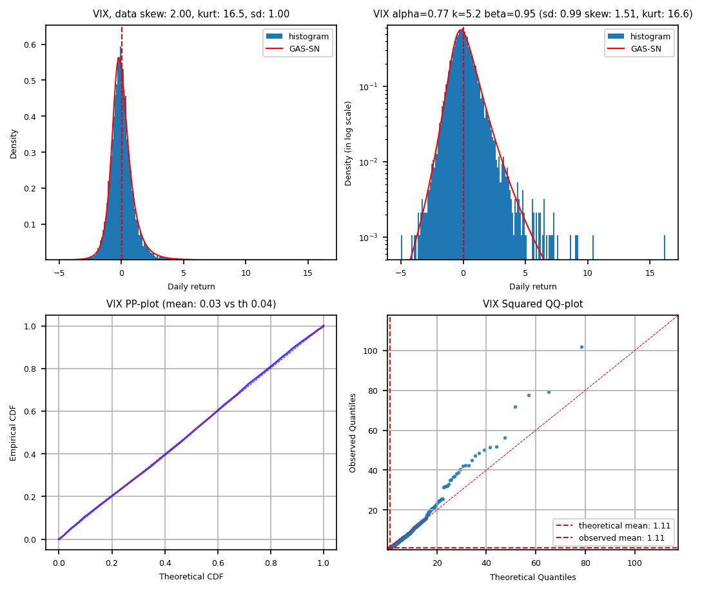
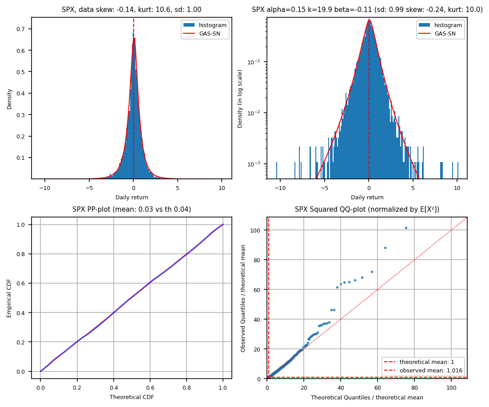
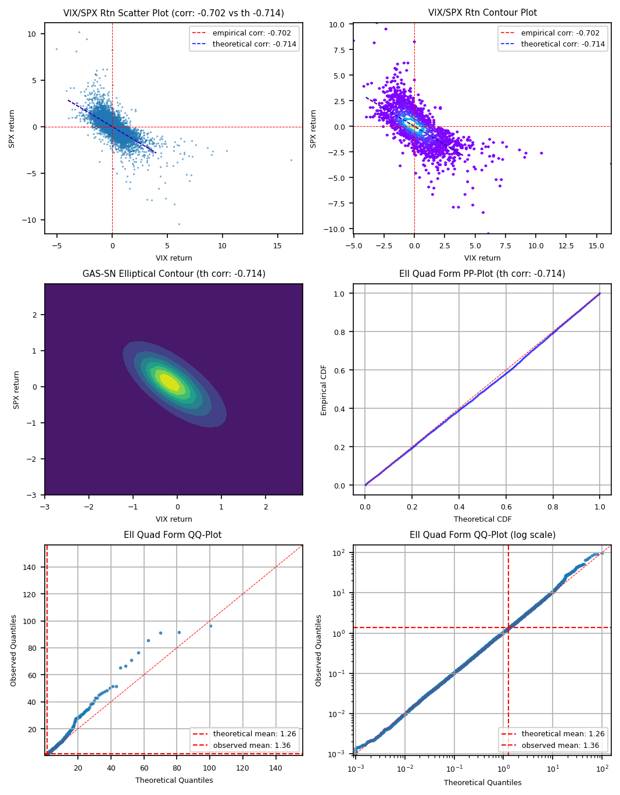

# gas-impl
## GAS-SN: generalized alpha-stable distribution with skew-normal family

## Overview - Fractional Distributions

This package was upgraded in 2025 to incorporate the skew-normal family, called GAS-SN. 
The GAS-SN distribution is the most flexible distribution to date; it can fit data sets with high skewness and kurtosis.

The content is written in a book format, available [here](docs/fracdist.pdf).
As of July 2026, the book is in the late editing stage.
In July 2026, I discovered that the fractional gamma distribution is equivalent
to the inverse power of the tilted stable law (Devroye, 2009).
The book might go through another revision, most likely a conceptual simplification.

As of October 2026, new results have been found. The book and the code library are under intense revision again.
A lognormal-normal (LNN) limit has been found in GSAS (the symmetric case of GAS-SN). A canonical coordinate system is proposed.
Any financial asset can be located on this chart from its kurtosis and peak density,
much like a phase diagram:


Near the lognormal limit, a connection to the tempered stable law has also been found.
I think the discovery of this limit is a big breakthrough for applications to real-world data.

## Reference Implementation

This package provides the reference implementation for all the distributions mentioned in the book.
See the test cases for usage examples. Every function is tested in at least one test case.

In late 2025, I decided to call this group of new distributions **The Fractional Distributions**.
Many classic distributions are generalized into fractional distributions, such as:
<table>
<tr>
<th> classic distribution </th><th> fractional distribution </th>
</tr><tr>
<td> generalized gamma distribution </td><td> fractional gamma distribution (Chapter 6)</td>
</tr><tr>
<td> chi/chi2 distribution </td><td> fractional chi/chi2 distribution (Chapter 7)</td>
</tr><tr>
<td> F distribution </td><td> fractional F distribution (Chapter 8)</td>
</tr><tr>
<td> univariate skew-t distribution </td><td> univariate GAS-SN distribution (Chapter 12)</td>
</tr><tr>
<td> stable / Cauchy distributions  </td><td> ditto</td>
</tr><tr>
<td> multivariate skew-t distribution </td><td> multivariate elliptical GAS-SN distribution (Chapter 15)</td>
</tr>
</table>

## Physical Interpretation

The parameters of this family have physical meanings in fractional transport problems, where they represent self-similar anomalous diffusion:

* $\alpha$ is the Lévy index that acts as the temporal scaling exponent.
* $p$ (fractional gamma distribution) acts as the spatial scaling exponent.

In the fractional chi/chi2 distribution, $p = \alpha$.
The space and time scales are synchronized. The PDF retains its exact shape as it dilates over time.
This makes the distribution structurally invariant under scaling transformations, 
establishing a bridge to fractional Brownian motion.

When $\alpha = 1$,

* $k$ is the degrees of freedom. It encapsulates the spatial dimension or fractal topology.


## Demo

To show how well the distribution fits, two univariate fits, to the VIX and SPX return distributions, are shown below:
<table>
<tr>
<td>  </td>
<td>  </td>
</tr>
</table>

The bivariate VIX-SPX data set is fitted with the bivariate elliptical GAS-SN distribution, as shown below:



My 2024 paper, which laid the foundation, is at:

https://arxiv.org/abs/2405.04693


## Installation

There are no plans to publish on PyPI yet. 

Install directly from GitHub:

```bash
pip install git+https://github.com/slihn/gas-impl.git#egg=gas_impl
```

If the above method doesn't work, a safer method is to `git clone` this repository into a local directory. 
Then run:

```bash
cd /path-to/gas-impl
pip install -e .
```

You can run the test cases to make sure everything is working on your platform:

```bash
cd /path-to/gas-impl
pytest
```

This package is developed under Linux/Ubuntu.
The `pandarallel` package is used for multicore processing when an array is sent to the `pdf` or `cdf` functions.
This part of the implementation may not work on other platforms.

## Example

Once you have installed the package, you can run the following snippets:

```python
from gas_impl.stats import gsas

g = gsas(alpha=1.1, k=2.5)
g.pdf(0.25)
```

The answer should be 0.32678...

Add skewness with the beta parameter:

```python
from gas_impl.stats import gas_sn

g = gas_sn(alpha=1.1, k=2.5, beta=0.5)
g.pdf(0.25)
```

The answer should be 0.35881...
